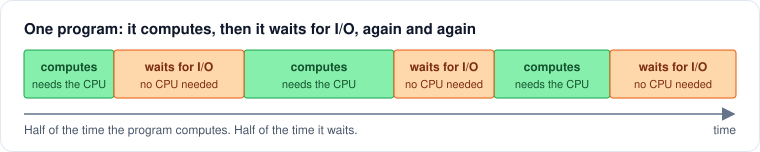
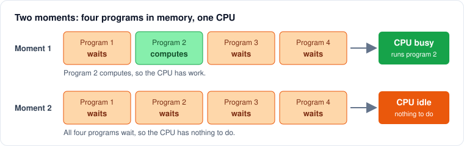
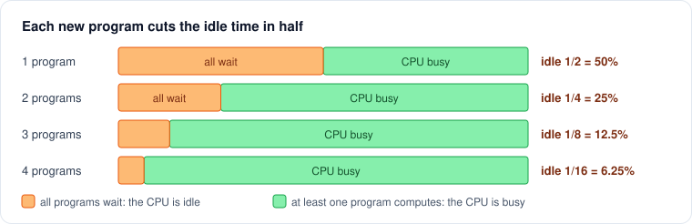
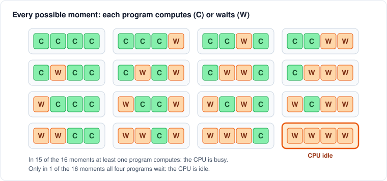
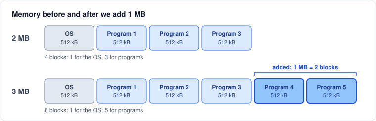
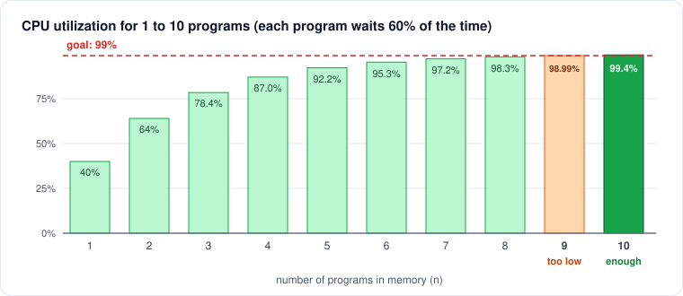
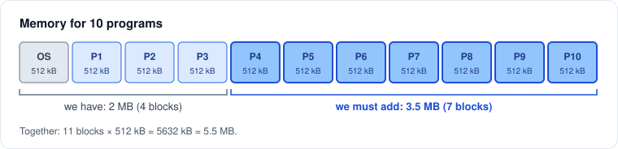

# Memory Management – Part 1

**Theory Exercises V: Memory management. Memory allocation algorithms in multiprocess systems.**

This lab covers Problems 1–5. Problems 6–10 come in Part 2.

## Introduction

A computer has a limited amount of main memory (RAM). Many programs want to run at the same time, and every program needs a place in memory. The operating system (OS) must decide:

- how many programs can be in memory at the same time,
- where each program is placed,
- what to do when memory is full or badly used.

Every decision has a price. In this lab we do not write code. We calculate. Each problem asks one simple question: *how much time or memory does this decision cost?* The problems come from the course slides [9].

| # | Question | Topic |
|---|----------|-------|
| 1 | How often does the CPU have nothing to do? | Multiprogramming with fixed partitions |
| 2 | Is it worth adding more memory? | Multiprogramming with fixed partitions |
| 3 | How expensive is compaction? | Multiprogramming with swapping |
| 4 | How much do page faults slow a program down? | Virtual memory with paging |
| 5 | How many bits does an address need? | Virtual memory with paging |

You need only basic maths: percentages, powers such as 2¹⁰, and a calculator.

### How each problem is organised

1. **The problem** – the text of the task.
2. **Understand the situation** – what is happening, in plain words and pictures.
3. **Solution, step by step** – the calculation with an explanation of every step.
4. **Answer** – the final result.

Numbers in square brackets, for example [1], point to the [References](#references) at the end.

## Key Terms

Read these terms first. We use them in all five problems.

### Programs, the CPU and waiting

- **Process** – a program that is running. A process "is a running program" [1, ch. 4]. In this lab the words *program* and *process* mean the same thing.
- **I/O (input/output)** – work with devices such as a disk, a keyboard or a network. I/O is slow. While a program waits for I/O, it cannot compute, so it does not use the CPU. The letter **p** is the part of its time that a program spends waiting for I/O [4, §2.1.7].
- **Idle** – the CPU is idle when no program can use it, because all programs in memory are waiting for I/O [3, §2.1.7].
- **Multiprogramming** – several programs are in memory at the same time, and the OS switches the CPU among them, for example when one of them starts an I/O operation. The goal is to use the CPU better [1, §13.2], [4, §2.1.7].
- **Degree of multiprogramming** – the number of processes that are in memory at the same time [2, §3.2]. In our formulas this is the letter **n**.
- **CPU utilization** – the part of the time when the CPU is busy. It is a number between 0% and 100% [2, §5.2].
- **Throughput** – the number of processes that finish in one unit of time [2, §5.2]. Problem 2 uses this word in a loose way: there it means CPU utilization.
- **Independent events** – two events are independent when one of them does not change the chance of the other. For independent events we can multiply: P(A and B) = P(A) × P(B) [7, §3.2].

### Sharing memory among programs

- **Fixed partitions** – memory is cut into several parts called *partitions*. Their borders do not move, and one program runs in one partition [4, "Multiprogramming with Fixed Partitions"]. So the number of partitions is the largest number of programs that can be in memory.
- **Swapping** – moving a whole process from memory to disk and back again [4, §3.2.2], [3, §3.2.2], [2, §9.5]. Problems 1 and 2 say *without swapping*. This means that a program stays in memory from its start to its end, also while it waits for I/O.
- **Segment** – a block of memory in one piece: "a contiguous portion of the address space of a particular length" [1, §16.1]. In Problem 3 a segment is one used block of memory.
- **Hole** – a free block of memory between used blocks [1, §16.6], [4, §3.2.2].
- **External fragmentation** – the free memory is cut into many small holes. A new program may not fit into any hole, although all the holes together are large enough [1, ch. 17].
- **Compaction** – the OS moves the used blocks together, so that all the free space becomes one large hole [1, §16.6], [3, §3.2.2]. Compaction costs CPU time, because the OS must copy memory.

### Paging and virtual memory

- **Address space** – "the running program's view of memory in the system" [1, §13.3].
- **Logical address** (also called *virtual address*) – an address that the program uses. **Physical address** – the real place in the memory hardware. The OS and the hardware translate every logical address into a physical address [2, §9.1], [1, §13.3].
- **Page** – the address space of a process is cut into units of the same size. One unit is a page [1, ch. 18].
- **Page frame** (or just *frame*) – physical memory is cut into slots of the same size. One slot is a page frame, and it can hold one page [1, ch. 18]. A page and a frame have the same size.
- **Page table** – a table that the OS keeps for every process. For each page it says in which frame the page is stored [1, §18.1].
- **Page number and offset** – an address has two parts. The page number says *which page*. The offset says *which place inside that page* [1, §18.1].
- **Page fault** – "the act of accessing a page that is not in physical memory" [1, §21.2]. The OS must first read the page from disk. This is slow [1, §21.3].
- **Word** – a unit of data with a fixed size that a processor works with [8]. In Problem 5 memory is counted in words: one address points to one word.

### Units

| Unit | Meaning in this lab |
|------|---------------------|
| 1 kB | 1024 bytes = 2¹⁰ bytes |
| 1 MB | 1024 kB = 1 048 576 bytes = 2²⁰ bytes |
| 1 ms (millisecond) | 0.001 s |
| 1 µs (microsecond) | 0.000 001 s, so 1 s = 1 000 000 µs |

Be careful with **MB**. In the official standard, 1 MB is 1 000 000 bytes, and the name for 2²⁰ bytes is *mebibyte* (MiB) [5], [6]. Older operating-system texts often write MB for 2²⁰ bytes. Problem 2 needs 1 MB = 1024 kB. In Problem 3 the lecture solution uses 1 MB = 1 000 000 bytes, so we show both results there.

### Powers of two

With **b** bits we can number 2ᵇ different things. This rule is all we need for Problem 5.

| Bits | 1 | 2 | 3 | 4 | 5 | 10 | 13 | 15 |
|------|---|---|---|---|---|----|----|----|
| Different values | 2 | 4 | 8 | 16 | 32 | 1024 | 8192 | 32 768 |

---

## Problem 1 – How Often Is the CPU Idle?

*Topic: multiprogramming with fixed partitions, without swapping.*

### The problem

A computer system has room in its main memory for **four programs**. On average, each program waits for I/O **50%** of the time. On average, what part of the CPU time is **not used**?

### Understand the situation

**1. A program does two things, again and again.**

- It **computes**. For this it needs the CPU.
- It **waits for I/O**. For this it does not need the CPU.

In this problem a program waits half of the time.



**2. Four programs share one CPU.**

All four programs stay in memory, also when they wait (there is no swapping). When one program waits, the CPU works for another program. So the CPU is idle only when **all four programs wait at the same moment**.



**3. The question.**

For what part of the time do all four programs wait at the same moment?

### Solution, step by step

**Step 1 – One program.** A program waits 1/2 of the time. With only one program in memory, the CPU is idle 1/2 of the time.

**Step 2 – Add a second program.** Look only at the time when program 1 waits. Program 2 waits during half of this time. So both programs wait during 1/2 of 1/2 of the time:

```
1/2 × 1/2 = 1/4
```

**Step 3 – Add the third and the fourth program.** Each new program cuts the idle time in half again:

```
1/2 × 1/2 × 1/2 × 1/2 = 1/16
```



We may multiply like this because the programs are **independent**: one program does not change when another program waits [7, §3.2].

**Step 4 – Change to percent.**

```
1 ÷ 16 = 0.0625 = 6.25 %
```

**Step 5 – Check by counting.** At any moment each program either computes (C) or waits (W). Four programs give 2 × 2 × 2 × 2 = 16 possible moments. All 16 have the same chance, because a program computes and waits equally often. In only one of them all four programs wait:



One of sixteen is 1/16. This is the same result.

**The general rule** [3, §2.1.7]. Let p be the part of the time that a program waits, and n the number of programs in memory:

```
idle time        = pⁿ
CPU utilization  = 1 − pⁿ
```

Here p = 0.5 and n = 4, so the idle time is 0.5⁴ = 0.0625. We use this rule again in Problem 2.

### Answer

On average **6.25%** of the CPU time is not used. The CPU is busy 93.75% of the time.

---

## Problem 2 – Is It Worth Adding More Memory?

*Topic: multiprogramming with fixed partitions, without swapping.*

### The problem

A computer has **2 MB** of memory. The operating system takes **512 kB**. Every running program also takes **512 kB**. All programs wait for I/O **60%** of the time.

- **(a)** By how many percent does the throughput (CPU utilization) grow if we add **1 MB** of memory?
- **(b)** How much memory must we add to bring the CPU utilization to **at least 99%**?

### Understand the situation

**1. Memory is cut into blocks of 512 kB.**

The operating system takes one block. Every program takes one block. So the size of the memory decides how many programs can run.

In this problem 1 MB = 1024 kB, so 1 MB is 2 blocks.



**2. More programs means a busier CPU.**

We know the rule from Problem 1: the CPU is idle only when all programs wait at the same moment.

```
idle time        = pⁿ
CPU utilization  = 1 − pⁿ
```

Here p = 0.6, because a program waits 60% of the time. The letter n is the number of programs.

**3. The two questions.**

Everything in this problem follows one chain:

```
size of memory  →  number of programs (n)  →  CPU utilization (1 − pⁿ)
```

- Part (a) goes from left to right. We know the memory, and we look for the CPU utilization.
- Part (b) goes from right to left. We know the CPU utilization (99%), and we look for the memory.

### Solution, step by step

#### Part (a)

**Step 1 – Count the programs.** Look at the picture of the memory:

```
2 MB = 4 blocks  →  1 OS + 3 programs
3 MB = 6 blocks  →  1 OS + 5 programs
```

**Step 2 – Find the CPU utilization.** We put n = 3 and n = 5 into the rule:

| Memory | Programs (n) | Idle time (0.6ⁿ) | CPU utilization (1 − 0.6ⁿ) |
|---|---|---|---|
| 2 MB | 3 | 0.6³ = 0.216 = 21.6% | 78.4% |
| 3 MB | 5 | 0.6⁵ = 0.07776 ≈ 7.8% | 92.2% |

**Step 3 – Find the growth.** The question asks how much the CPU utilization grows. So we subtract the value before from the value after:

```
92.224 % − 78.4 % = 13.824 %  ≈  13.8 %
```


The lecture solution subtracts the idle times instead: 21.6% − 7.776% = 13.824%. It is the same number, because every percent that the CPU is not idle any more is a percent that it is busy.

#### Part (b)

**Step 1 – Write the goal.** We start from the goal and change it step by step, until only 0.6ⁿ is on one side:

```
CPU utilization ≥ 99 %      the goal
1 − idle time   ≥ 0.99      the CPU is busy or idle, so utilization = 1 − idle time
1 − 0.6ⁿ        ≥ 0.99      idle time = 0.6ⁿ (the rule from Problem 1)
0.6ⁿ            ≤ 0.01      the CPU may be idle at most 1 % of the time
```

**Step 2 – Find n by trying numbers.** We add one program after another, until the CPU utilization is at least 99%:



| Programs (n) | Idle (0.6ⁿ) | CPU utilization | At least 99%? |
|---|---|---|---|
| 8 | 1.680% | 98.320% | no |
| 9 | 1.008% | 98.992% | no, a little too low |
| **10** | **0.605%** | **99.395%** | **yes** |

So we need n = 10 programs.

**Step 3 – Find n with a logarithm (another way to the same result).** The unknown n is an exponent. A logarithm is the tool that finds an exponent: for example log(100) = 2, because 10² = 100 [10, §6.3].

A calculator has two logarithm keys: `log` (base 10) and `ln` (base e ≈ 2.718) [10, §6.3]. Both give the same n here. We use `log`. The rule we need moves the exponent down: log(aⁿ) = n × log(a) [10, §6.5].

```
0.6ⁿ ≤ 0.01
n × log(0.6) ≤ log(0.01)        take the logarithm of both sides; n comes down
n × (−0.22185) ≤ −2             values from the calculator
n ≥ 9.015…                      divide by a negative number: ≤ turns into ≥
```

With `ln` the result is the same: (−4.60517) ÷ (−0.51083) = 9.015…

The number of programs must be a whole number, and it must be at least 9.015. So n = 10.

**Step 4 – Change the programs back to memory.**

```
10 programs + 1 OS = 11 blocks
11 × 512 kB = 5632 kB = 5.5 MB
5.5 MB − 2 MB = 3.5 MB to add
```



### Answer

- **(a)** CPU utilization grows from 78.4% to 92.2%. This is **about 13.8%** more.
- **(b)** We need 10 programs in memory, so 5.5 MB in total. We must add **3.5 MB** to the first computer (2 MB). If we start from the 3 MB computer of part (a), we must add 2.5 MB more.

**What we learn.** The first extra 1 MB gave us 13.8% (from 78.4% to 92.2%). The next 2.5 MB give us only 7.2% (from 92.2% to 99.4%). More memory always helps, but every step helps less.

---

## References

1. R. H. Arpaci-Dusseau, A. C. Arpaci-Dusseau. *Operating Systems: Three Easy Pieces*, version 1.10. Arpaci-Dusseau Books. Free online: <https://pages.cs.wisc.edu/~remzi/OSTEP/>. Chapters used: [4 – The Abstraction: The Process](https://pages.cs.wisc.edu/~remzi/OSTEP/cpu-intro.pdf), [13 – The Abstraction: Address Spaces](https://pages.cs.wisc.edu/~remzi/OSTEP/vm-intro.pdf), [16 – Segmentation](https://pages.cs.wisc.edu/~remzi/OSTEP/vm-segmentation.pdf), [17 – Free-Space Management](https://pages.cs.wisc.edu/~remzi/OSTEP/vm-freespace.pdf), [18 – Paging: Introduction](https://pages.cs.wisc.edu/~remzi/OSTEP/vm-paging.pdf), [21 – Beyond Physical Memory: Mechanisms](https://pages.cs.wisc.edu/~remzi/OSTEP/vm-beyondphys.pdf).
2. A. Silberschatz, P. B. Galvin, G. Gagne. *Operating System Concepts*, 10th edition. Wiley, 2018. Sections 3.2 (Process Scheduling), 5.2 (Scheduling Criteria), 9.1 (Background), 9.5 (Swapping). Table of contents: <https://www.os-book.com/OS10/toc-dir/toc.pdf>.
3. A. S. Tanenbaum, H. Bos. *Modern Operating Systems*, 4th edition. Pearson, 2015. Sections 2.1.7 (Modeling Multiprogramming) and 3.2.2 (Swapping).
4. A. Gottlieb. *Operating Systems – Class Notes* (CSCI-UA.202). New York University. The section numbers follow [3]. <https://cs.nyu.edu/~gottlieb/courses/os202/class-notes.html>.
5. National Institute of Standards and Technology (NIST). *Prefixes for binary multiples*. <https://physics.nist.gov/cuu/Units/binary.html>.
6. National Institute of Standards and Technology (NIST). *Metric (SI) Prefixes*. <https://www.nist.gov/pml/owm/metric-si-prefixes>.
7. B. Illowsky, S. Dean. *Introductory Statistics 2e*. OpenStax. Section 3.2 (Independent and Mutually Exclusive Events). <https://openstax.org/books/introductory-statistics-2e/pages/3-2-independent-and-mutually-exclusive-events>.
8. Wikipedia. *Word (computer architecture)*. <https://en.wikipedia.org/wiki/Word_(computer_architecture)>.
9. Course slides: *Operačné systémy – Teoretické cvičenia V. Správa pamäti. Algoritmy prideľovania pamäti v multiprocesových systémoch.* The problems and the solution methods in this lab come from these slides and their speaker notes.
10. J. Abramson. *College Algebra 2e*. OpenStax. Sections [6.3 (Logarithmic Functions)](https://openstax.org/books/college-algebra-2e/pages/6-3-logarithmic-functions) and [6.5 (Logarithmic Properties)](https://openstax.org/books/college-algebra-2e/pages/6-5-logarithmic-properties).
