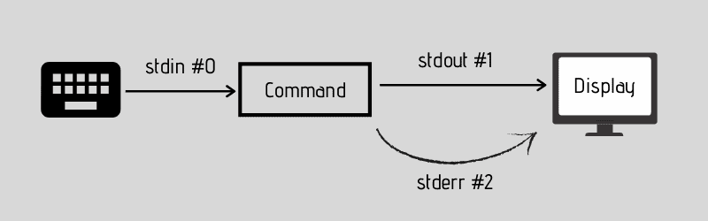

# Lab 3: Forking Around

Manage Linux processes and jobs, and connect commands through pipes and redirection. Examples use `/public` course files and Linux devices.

---

## Table of Contents

- [1. Processes, Jobs, and Lab Goals](#1-processes-jobs-and-lab-goals)
- [2. Inspect Processes with `ps`](#2-inspect-processes-with-ps)
- [3. Jobs, Foreground, Background, and Signals](#3-jobs-foreground-background-and-signals)
- [4. Control Jobs](#4-control-jobs)
- [5. Pipes and Redirection](#5-pipes-and-redirection)
- [6. Command Substitution](#6-command-substitution)
- [7. Sources](#7-sources)

---

## 1. Processes, Jobs, and Lab Goals

A **process** is a running instance of a program. Linux gives it a process ID (**PID**) and manages its memory, CPU time, and other resources. A process still exists while waiting or paused; it does not have to use the CPU continuously.

A **job** is a command or pipeline managed by your shell. It can contain one or several processes. Bash uses job numbers to let you pause, resume, or bring jobs to the foreground. **A PID identifies a process; a job number belongs to one shell.**

In this lab, we will:

- Inspect processes with `ps` and `top`, including memory usage and process states.
- Work with foreground, background, and stopped jobs using `&`, `jobs`, `bg`, and `fg`.
- Send signals with Ctrl+Z, Ctrl+C, and `kill` to pause or end jobs.
- Connect commands with pipes and substitution, redirect input/output, and check exit status.

Use Bash on the course Linux server. The examples work with `/public` files and Linux devices.

### Last Command Status

Bash keeps the previous foreground command/pipeline's exit status in **`$?`**; **`echo $?`** displays it. Check immediately, because another command replaces it. Zero normally means success; nonzero meanings depend on the command. GNU grep uses 1 for no selected lines and 2 for an error.

By default, a pipeline's status comes from its **last** command, not every stage. A successful wc or cat therefore does not prove that the producer succeeded. Bash's `pipefail` option changes this behavior. A foreground program terminated by Ctrl+C normally gives status 130.

[Back to top](#table-of-contents)

---

## 2. Inspect Processes with `ps`

`ps` means **process status**. It shows a snapshot, usually one row per process. Its options answer two separate questions: **which processes should appear, and which columns should be shown?**

### Start with `ps`

Without options, ps selects processes with your effective user ID and the same controlling terminal. It is a quick view of your current terminal's processes, not the whole system.

```bash
ps                                     # Show processes for your user and terminal.
```

The default columns are `PID` (process ID), `TTY` (terminal), `TIME` (CPU time used), and `CMD` (command name). **TIME is not how long the process has existed.**

### Choose a System-Wide View

| Command | Processes selected | Use it to inspect |
|---|---|---|
| `ps aux` | All visible processes, including those without a terminal. | CPU usage, RAM usage, and process states. |
| `ps -elf` | The same all-process selection. | Parent processes, scheduling details, and command arguments. |

**The main difference is the columns, not foreground versus background.** Both include foreground and background processes. Separate snapshots can differ if processes start or finish between commands.

### `ps aux`: CPU, Memory, and State

These options have **no leading dash**:

| Option | Meaning |
|---|---|
| `a` | Include other users' terminal-associated processes. |
| `x` | Include processes without a controlling terminal; together `a` and `x` select all. |
| `u` | Show the owner and CPU/memory columns. |

```bash
ps aux                                 # All processes, with CPU, memory, and state information.
```

| Column | Meaning |
|---|---|
| `USER` | Process owner. |
| `PID` | Process ID, not a job number. |
| `%CPU` | CPU usage averaged over the process's lifetime. |
| `%MEM` | Resident memory as a percentage of physical memory. |
| `VSZ` | Virtual memory size in KiB. |
| `RSS` | Resident physical memory in KiB. |
| `TTY` | Controlling terminal; `?` means none. |
| `STAT` | Main state plus optional markers. |
| `START` | Start time or date. |
| `TIME` | Accumulated CPU time, not elapsed time since starting. |
| `COMMAND` | Command and arguments. |

#### Decode `STAT`

The first letter is the process state. Following characters add details such as session leadership or foreground placement.

| State / combination | Meaning |
|---|---|
| `R` | Running on a CPU or ready to run. |
| `S` | Sleeping: waiting for an event, input, or another resource. |
| `D` | Uninterruptible sleep, commonly associated with I/O. |
| `T` | Stopped by a job-control signal; paused, not finished. |
| `Z` | Exited, but its parent has not collected its exit status. |
| `Ss` | Sleeping AND a session leader. Lowercase s is an extra marker. |
| `R+` | Runnable AND part of the terminal's foreground process group. |
| `S+` | Sleeping AND in the foreground process group. |
| `Ss+` | Sleeping, a session leader, and in the foreground process group. |

`S` is not `T`: a sleeping process can wake when its event occurs; a stopped process needs to be continued. A quiet terminal does not prove that a process is sleeping or stopped.

**There is no standard `R-` opposite to `R+` in Linux ps.** Without `+`, a runnable process can simply show `R`, perhaps with other markers. Absence of `+` may also mean there is no controlling terminal, not that this shell started a background job.

#### Session Leader and Foreground Group

A **session** groups related process groups, often for a terminal login. Its **session leader** is the process that created it; the leader's PID equals the session ID. A login shell is often a session leader, but a shell started inside another shell need not be one.

A **process group** lets the shell and terminal control related processes together. In an interactive shell, the processes of a pipeline normally form one job/process group. Each controlling terminal has **one foreground process group at a time**.

- While you have a prompt, Bash is in the foreground.
- When a foreground command runs, Bash waits and gives that job the foreground position.
- When it finishes or stops, Bash takes the foreground position back.
- `+` in ps means foreground-group membership, not extra CPU use or higher priority.

Do not confuse ps with jobs: **`+` in `jobs` means the shell's current job**, and `-` means its previous job. Either can be stopped or running in the background.

#### What Does `pts/0` Mean?

`TTY` identifies the process's **controlling terminal**. `pts/0` refers to `/dev/pts/0`, a **pseudo-terminal**: a software terminal commonly used by an SSH session or a graphical terminal window. The number identifies the terminal, not a process, job, or user.

| TTY value | Meaning |
|---|---|
| `pts/0`, `pts/1`, ... | Different pseudo-terminals. Numbers are assigned when terminals are created and can be reused after they close. |
| `tty1`, `tty2`, ... | Linux virtual consoles, commonly used for local text logins. |
| `ttyS0`, `ttyS1`, ... | Serial terminals, when used as controlling terminals. |
| `ttyUSB0`, ... | USB serial terminals, when used as controlling terminals. |
| `?` | No controlling terminal, common for services and kernel threads. |

Several processes can share `pts/0`, including the shell and its foreground or background jobs. **TTY does not tell you whether a job is in the background.** It also does not show where stdout is redirected: writing output to a file does not by itself remove the controlling terminal.

### `ps -elf`: Parents and Scheduling

Here the letters are grouped **after a dash**:

| Option | Meaning |
|---|---|
| `-e` | Select all visible processes. |
| `-l` | Use long format, adding state and scheduling details. |
| `-f` | Use full format, including parent IDs and command arguments. |

```bash
ps -elf                                # All processes in long/full format.
```

Useful columns in this view include:

| Column | Meaning |
|---|---|
| `UID`, `PID`, `PPID` | Process owner, process ID, and parent process ID. PPID shows which process is its parent. |
| `S` | Main state letter only; unlike `STAT`, it does not include extra markers such as `+`. |
| `C`, `STIME` | Integer CPU-use percentage over the process's lifetime, and start time/date. |
| `PRI`, `NI` | Scheduling priority and nice value; neither measures actual CPU use. |
| `SZ` | Process size in page units, not resident RAM in KiB. |
| `WCHAN` | Wait channel: the kernel function where a process is sleeping, when available. |
| `F`, `ADDR` | Process flags and a legacy address field; ADDR commonly shows `-`. |
| `TTY`, `TIME`, `CMD` | Terminal, accumulated CPU time, and command with arguments. |

`ps -ef` omits the extra long-format fields from `-l`, but still shows all processes with parent IDs and command arguments. **Full format does not mean every available column.**

#### What Is `WCHAN`?

**WCHAN means wait channel.** It names the kernel function where a sleeping process is waiting. This can help explain whether it is waiting for input, a timer, another process, or synchronization. It is **not a waiting-time counter**.

A placeholder such as `-` or `0` can mean the process is not sleeping or the information is unavailable, including permission restrictions. Read it alongside the process state (`S` or `STAT`); a missing name alone does not prove the process is running.

#### What Does `PPID = 0` Mean?

Normally, PPID identifies a parent you can find in the process list. **PPID 0 means there is no ordinary parent PID to show in the current process view.** Common cases are:

- Kernel-created startup processes, such as the system's PID 1 (`init` or `systemd`) and `kthreadd`.
- A parent outside the current **PID namespace**, a separate process-numbering view often used by containers. That parent is not visible from inside the namespace.

PPID 0 does **not** mean the process runs as root: root is **UID 0**, a different column. It also does not simply mean the parent died; an orphaned process is normally adopted by PID 1 or another designated process called a subreaper.

### `-a` and `-A` Are Different

Both commands below use `-l` (long format) and `-f` (full format). **They show the same columns, but select different processes.**

- **Lowercase `-a`:** show processes that have a controlling terminal **and are not session leaders**. A session leader starts a session and is often the login shell.
- **Uppercase `-A`:** show **all visible processes**, including session leaders and processes without a terminal. It means the same as `-e`.

| Process | `ps -lfa` | `ps -lfA` |
|---|---|---|
| A command attached to a terminal, not a session leader | Included | Included |
| A login shell that is a session leader | Excluded | Included |
| A service with no controlling terminal (`TTY` is `?`) | Excluded | Included |

```bash
ps -lfa                                # Terminal-associated processes, except session leaders.
ps -lfA                                # All visible processes; same selection and format as ps -elf.
```

`-a` can include other users' processes and background jobs; it does not mean "only my terminal" or "only foreground jobs." **Use `-A` or `-e` when you want the complete process list.**

Keep `ps aux` without a dash: `ps -aux` has an ambiguous interpretation involving a user named x. Changing case or adding a dash can change an option's meaning.

### Watch Changes with `top`

```bash
top                                    # Continuously update the process display; press q to quit.
man ps                                 # Read ps option and column definitions; q exits.
man top                                # Read the interactive monitor's manual; q exits.
```

Use **ps for a snapshot** and **top for an updating view**.

[Back to top](#table-of-contents)

---

## 3. Jobs, Foreground, Background, and Signals

A **job** is a command or pipeline managed by the current shell. It can contain one or several processes. The shell's job number is different from any process PID and belongs only to that shell's job table.

| Situation | What it means |
|---|---|
| Foreground job | Has the foreground terminal position; Bash waits instead of offering another prompt. |
| Background job | Continues while Bash lets you type more commands. It can still write to the terminal. |
| Stopped job | Paused, but its processes still exist. |

Foreground/background describes the relationship to the terminal, not CPU consumption. A background job can be busy; a foreground job can be waiting. Normally only foreground processes can read terminal input. A background process attempting to read it is normally stopped by `SIGTTIN`.

### Job-Control Commands

```bash
jobs                                   # List this shell's active background/stopped jobs.
help jobs                              # Read Bash's builtin job-list documentation.
help fg                                # Read how to bring an existing job to the foreground.
help bg                                # Read how to continue an existing stopped job in the background.
```

| Command | When and why to use it |
|---|---|
| `command &` | Start a new command in the background and keep the prompt. |
| `bg` | Continue the current stopped job in the background, without starting another copy. |
| `fg` | Bring the current job to the foreground and continue it if stopped. Useful for keyboard interaction/signals. |
| `fg %2` | Select job 2 explicitly, if it exists in this shell. |
| `kill %1` | Send the default termination request, `SIGTERM`, to job 1. |
| `kill 679` | Signal PID 679, not job 679. Check which process owns that PID before using it. |

An empty jobs listing does not mean the system has no processes. `fg` and `bg` report an error if there is no suitable job. Appending `&` does not guarantee that the job survives logout.

### Keyboard Actions Send Signals

A **signal** is a notification to a process. It can interrupt, stop, continue, or terminate it, depending on the signal and the program's handling.

| Action | Signal and effect |
|---|---|
| Press Ctrl+Z | Terminal sends `SIGTSTP` to the foreground process group; normally pauses the job and returns a shell prompt. |
| Press Ctrl+C | Terminal sends `SIGINT` to the foreground process group; normally interrupts the program. |
| Resume a stopped job with bg/fg | The shell continues it using `SIGCONT`, with the chosen terminal placement. |
| `kill %1` | Defaults to `SIGTERM`, a request to terminate, not an unconditional force kill. |

Ctrl+Z does not save or close a program. Ctrl+C at a shell prompt does not target all background jobs. Bring the intended job forward or signal it explicitly. Bash's builtin `kill -l` lists the signal names; `help kill` describes that builtin. `man kill` may describe the separate external program's options.

[Back to top](#table-of-contents)

---

## 4. Control Jobs

Follow one job from **foreground to stopped to background**, then end it. Run each step separately in the same Bash terminal. These device readers have no normal end of input and can use substantial CPU, so finish the cleanup promptly.

### Start in the Foreground

```bash
hexdump -x /dev/zero                    # Read zero bytes and display two-byte hexadecimal units.
```

Bash waits, so there is no new shell prompt. Repeated output may collapse to an asterisk (`*`), but the process is still reading and using CPU. **Quiet output does not mean stopped.**

### Pause the Job

**Press Ctrl+Z** to send `SIGTSTP` to the foreground job. It pauses and Bash returns a prompt.

```bash
jobs                                   # Check that the job is Stopped and note its job number.
```

### Resume in the Background

```bash
bg                                     # Send SIGCONT to resume the current stopped job.
ps                                     # Inspect processes while the job continues.
jobs                                   # Check that the job is now Running.
```

You can type commands while the job runs. **Bg resumes the existing job; it does not start a second copy.** Background output can still appear on your terminal.

### Bring It Forward and End It

```bash
fg                                     # Give the current job the foreground position again.
```

Now **press Ctrl+C**. The terminal sends `SIGINT` to that job, normally ending hexdump. At a shell prompt, Ctrl+C would not target this background job; that is why we bring it forward first.

```bash
jobs                                   # Confirm the job has finished.
```

### Start in the Background with `&`

```bash
hexdump -x /dev/zero &                  # Start a NEW job in the background; keep the prompt.
jobs                                   # Find its actual job number.
```

Use the next command **only if this reader is job 1**; otherwise substitute its job number.

```bash
kill %1                                # Send SIGTERM to job 1 without bringing it forward.
jobs                                   # Check for termination; the finished job is then removed.
```

`&` starts a new background job; `bg` resumes a stopped one; `fg` gives an existing job the foreground. Use `fg %2` only when the intended job is number 2. End all device readers you started before leaving.

### Compare the Device Input

```bash
hexdump -x /dev/urandom                 # Display pseudorandom bytes instead of zeros.
```

Output keeps changing. **Press Ctrl+C promptly** to end this foreground command.

`-x` displays two-byte units in native byte order. Newer util-linux versions also support `-X` for one-byte hex; check the installed manual. Neither option limits the input length.

`cat hexdump -x /dev/zero` does not run hexdump: it passes those arguments to cat, which normally rejects `-x`.

[Back to top](#table-of-contents)

---

## 5. Pipes and Redirection

Pipes and redirection both control a command's input and output. **A pipe connects commands; redirection connects a stream to a file or another stream.**



| Descriptor | Stream | Normal terminal connection |
|---|---|---|
| 0 | Standard input, stdin | Keyboard input. |
| 1 | Standard output, stdout | Normal results on the display. |
| 2 | Standard error, stderr | Diagnostics on the display. |

A pipe, `|`, connects one command's **stdout** to the next command's **stdin**. Stderr stays separate. A program with explicit input files may read those instead of the pipe.

### Pipe Output to Another Command

```bash
man bash | wc -l                       # Count the lines in the formatted manual output.
```

Man writes text to stdout. The pipe passes it to wc's stdin, and `wc -l` prints the newline count. The intermediate text is not saved to a file.

### Why the `cat` Examples Ignore the Pipe

```bash
cd /public/
tail -10 zaciatocnik.txt | cat ls
# Tail produces the last ten lines, but cat reads the named file ls instead of stdin.
tail -10 zaciatocnik.txt | cat ls ls
# Cat reads the named file twice. It still does not consume the tail output as its input.
```

Use cat on `/public/ls` only after confirming it is text. `tail -10` is an older spelling of `tail -n 10`; both select ten lines.

Cat reads stdin when no files are named; otherwise it reads the named files. The operand `-` explicitly means stdin. If all pipe readers close, a writer can receive `SIGPIPE`, though a small producer may finish first.

### Save Output to a File

```bash
cd                                     # Return home before writing output.
history > cviko2a.txt                   # Save the command list to a file, not another command.
less cviko2a.txt                        # Read the saved text; press q to return.
```

Bash handles `>`: it creates the destination or empties an existing file **before** the command runs. Do not overwrite important work or shared `/public` inputs. Unlike a pipe, this keeps the result in a file.

| Output form | Meaning |
|---|---|
| `> file` or `1> file` | Create/replace a file with stdout. |
| `>> file` | Append stdout without erasing existing contents. |
| `2> file` | Save stderr instead of stdout. |
| `> file 2>&1` or `&> file` | Save stdout and stderr together. |
| `>> file 2>&1` or `&>> file` | Append both streams. |

`file` is a placeholder for an output pathname. In `> wc`, wc is a **filename**, not a command to execute. `>>>` is invalid syntax; use `>>` to append. Never redirect output into the file being read.

### Read Input from a File

```bash
grep najfrekventovanejsimi /public/zaciatocnik.txt
# Grep opens the named file and prints lines containing this word.
grep najfrekventovanejsimi < /public/zaciatocnik.txt
# Bash opens the same file and supplies it as grep's stdin.
```

Both search the same text. `<` connects a file to stdin; `|` connects another command's output to stdin. In either case, grep reads stdin when no filename operand is given.

[Back to top](#table-of-contents)

---

## 6. Command Substitution

**Command substitution** inserts a command's stdout into another command's arguments. The syntax is `$(command)`; Bash runs the inner command first and removes trailing newlines from its output. Backticks are the older spelling.

| Mechanism | Where the data goes |
|---|---|
| Pipe: `\|` | Into the next command's stdin. |
| Input redirection: `<` | From a file into stdin. |
| Substitution: `$(command)` | Into the surrounding command's arguments. |

Double-quote a substitution when its result should remain one argument. Unquoted output can be split into words and expanded as filename patterns. A list of filenames needs special care; lab4 covers file selection and passing names to commands.

[Back to top](#table-of-contents)

---

## 7. Sources

- [GNU Bash job control](https://www.gnu.org/software/bash/manual/html_node/Job-Control-Basics.html): job tables, process groups, foreground placement, and keyboard signals.
- [GNU Bash redirections](https://www.gnu.org/software/bash/manual/html_node/Redirections.html): connecting standard input and output to files.
- [GNU Bash manual](https://www.gnu.org/software/bash/manual/bash.html): command lookup, quoting, substitution, builtins, and status.
- [Linux ps manual](https://man7.org/linux/man-pages/man1/ps.1.html): selection flags, memory columns, state markers, and formats.
- [Linux wait channel](https://man7.org/linux/man-pages/man5/proc_pid_wchan.5.html): sleeping kernel functions and access restrictions.
- [Linux parent process IDs](https://man7.org/linux/man-pages/man2/getppid.2.html): reparenting and parents outside a PID namespace.
- [util-linux hexdump manual](https://man7.org/linux/man-pages/man1/hexdump.1.html): hexadecimal formats and duplicate suppression.
- [GNU Coreutils manual](https://www.gnu.org/software/coreutils/manual/coreutils.html): cat's input operands, tail, and wc.

[Back to top](#table-of-contents)