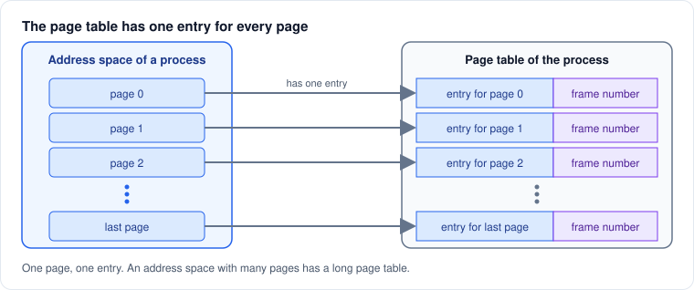
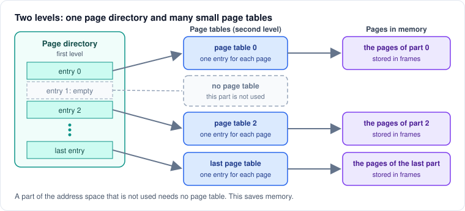
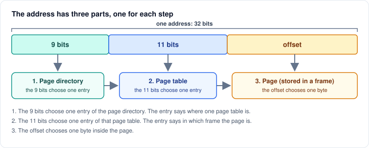
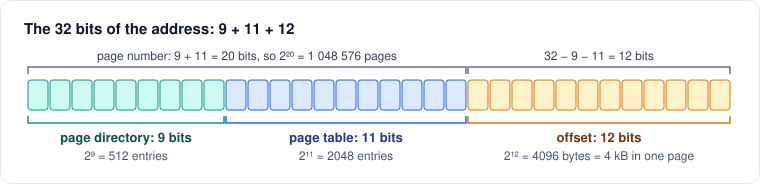
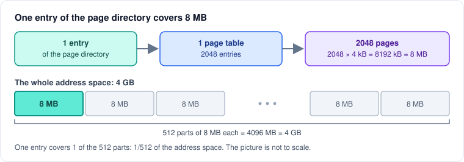
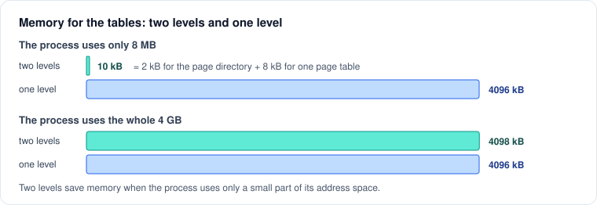
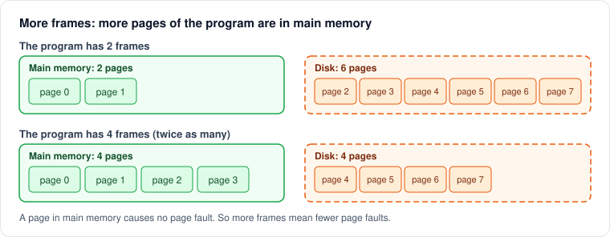
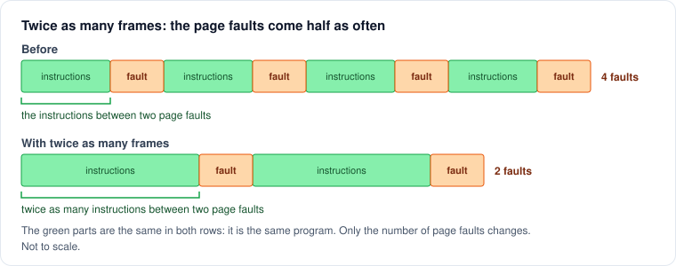

# Memory Management – Part 2

**Theory Exercises V: Memory management. Memory allocation algorithms in multiprocess systems.**

This lab covers Problems 6–10. Problems 1–5 are in Part 1, on the branch `lab9-memory-allocation-1`.

## Introduction

In Part 1 we met paging. Memory is cut into pages and frames, and a page table says where each page is stored. Paging has no external fragmentation. But paging has its own price: the page table can be very long, and every address that a program uses must be translated.

In this lab we calculate this price. Again we do not write code. The problems come from the course slides [4].

| # | Question | Topic |
|---|----------|-------|
| 6 | How much CPU time does loading the page table take? | Page table in the hardware |
| 7 | How does a two-level page table split an address? | Two-level page tables |
| 8 | How much faster is a program with twice as many frames? | Page faults |
| 9 | What hit rate does the associative memory need? | Associative memory |
| 10 | How long does it take to read a program from disk? | Reading pages from a disk |

You need only basic maths: percentages, powers such as 2¹⁰, and a calculator.

### How each problem is organised

1. **The problem** – the text of the task.
2. **Understand the situation** – what is happening, in plain words and pictures.
3. **Solution, step by step** – the calculation with an explanation of every step.
4. **Answer** – the final result.

Numbers in square brackets, for example [1], point to the [References](#references) at the end.

## Key Terms

Read these terms first.

### Terms from Part 1

- **Logical address** – an address that the program uses. **Physical address** – the real place in the memory hardware [1, §13.3].
- **Page** – a block of the logical memory of a process. **Frame** – a block of the physical memory. A page and a frame have the same size, and each page is stored in one frame [1, ch. 18].
- **Page table** – a table that the OS keeps for every process. For each page it says in which frame the page is stored [1, §18.1].
- **Page number and offset** – an address has two parts. The page number says *which page*. The offset says *which place inside that page* [1, §18.1].
- **Page fault** – a program uses a page that is not in physical memory. The OS must first read the page from disk, and this is slow [1, §21.2].

### New terms

- **32-bit address space** – every address has 32 bits. So a process can use 2³² different addresses [1, §18.2].
- **Page table entry** – one line of the page table. It holds the frame number of one page [1, §18.3]. The page table has one entry for every page.
- **Process switch** (also called *context switch*) – the OS stops running one process and starts running another one [1, §6.3].
- **Two-level page table** – a page table that is cut into many small page tables. A small page table exists only for a part of the address space that the process uses [1, §20.3].
- **Page directory** – the table of the first level. Each of its entries says where one small page table is, or that this page table does not exist [1, §20.3].
- **Overhead** – here: the memory that the page tables themselves take. This memory is not free for programs [1, ch. 20].
- **Directly proportional** – two numbers are directly proportional when one of them is always the other one multiplied by the same constant [5, §5.8]. So when one number becomes twice as large, the other one becomes twice as large too.

### Units

| Unit | Meaning in this lab |
|------|---------------------|
| 1 kB | 1024 bytes = 2¹⁰ bytes |
| 1 MB | 1024 kB = 2²⁰ bytes |
| 1 GB | 1024 MB = 2³⁰ bytes |
| 1 ms (millisecond) | 0.001 s |
| 1 µs (microsecond) | 0.000 001 s, so 1 s = 1 000 000 µs |
| 1 ns (nanosecond) | 0.000 000 001 s, so 1 ms = 1 000 000 ns |

Be careful with **kB**, **MB** and **GB**. In the official standard, 1 kB is 1000 bytes, and the name for 1024 bytes is *kibibyte* (KiB) [2], [3]. Our problems use the steps of 1024.

### Powers of two

With **b** bits we can write 2ᵇ different numbers.

| Bits | 9 | 10 | 11 | 12 | 13 | 19 | 20 | 32 |
|------|---|----|----|----|----|----|----|----|
| Different numbers | 512 | 1024 | 2048 | 4096 | 8192 | 524 288 | 1 048 576 | 4 294 967 296 |

---

## Problem 6 – How Much CPU Time Does Loading the Page Table Take?

*Topic: virtual memory with paging, page table in the hardware.*

### The problem

A computer has a **32-bit** address space and pages of **8 kB**. The page table of the running process is kept in the hardware. Each entry of the table has **32 bits**. When a process starts (or when the CPU switches to it), its page table is copied from memory into the hardware. Copying one entry takes **100 ns**. Every process runs for **100 ms**, and this includes the time for loading the table. What part of the CPU time is used for loading page tables?

### Understand the situation

**1. The page table has one entry for every page.**

The address space of a process is cut into pages. The page table says, for each page, in which frame it is stored. One line of the table is one **entry**.

So an address space with many pages has a long page table.



**2. At every process switch, the page table must be loaded.**

> **Hint:** The hardware must translate every address that a program uses, so this must be fast. Looking into a table in memory is slow [1, §18.4]. This computer keeps the table of the running process inside the hardware.

Every process has its own page table. When the CPU switches to another process, the OS copies the page table of that process from memory into the hardware. It copies one entry after another, and one entry takes 100 ns. During this time the process cannot run.


**3. The question.**

Every process gets 100 ms. The first part of these 100 ms is lost for loading. How large is this part?

Everything follows one chain:

```
page size  →  number of pages  →  number of entries  →  loading time  →  part of the 100 ms
```

### Solution, step by step

**Step 1 – Split the address.** An address has 32 bits. It is a page number and an offset, as in Problem 5 of Part 1. The offset chooses one byte inside a page, and a page has 8 kB:

```
8 kB = 8 × 1024 bytes = 8192 bytes = 2¹³ bytes   →   offset = 13 bits
page number = 32 − 13 = 19 bits
```


**Step 2 – Count the pages.** With 19 bits we can write 2¹⁹ different page numbers. There is one entry for every page:

```
2¹⁹ = 524 288 pages   →   524 288 entries in the page table
```

**Step 3 – Find the loading time.** Copying one entry takes 100 ns:

```
524 288 entries × 100 ns = 52 428 800 ns ≈ 52.43 ms       (1 ms = 1 000 000 ns)
```

**Step 4 – Find the part of the CPU time.** Every process has 100 ms, and 52.43 ms of them are used for loading:

```
52.43 ms ÷ 100 ms ≈ 0.524  ≈  52 %
```


### Answer

Loading page tables uses about **52%** of the CPU time. For more than half of the time the CPU only copies tables.

**What we learn.** The page table of a large address space is very long. Copying the whole table at every process switch is far too expensive. Real systems leave the page table in memory and keep only a few entries in fast hardware [1, ch. 19]. This is the associative memory of Problem 9.

### Notes on this solution

- **What are the 32 bits of an entry for?** We do not need them for the time, because the problem gives the time for one entry. They tell us the size of the table: 524 288 entries × 4 bytes = 2 097 152 bytes = 2 MB for every process.
- **Bytes, not words.** In Problem 5 the addresses counted words. Here the page size is given in kB, so one address points to one byte.

---

## Problem 7 – How Does a Two-Level Page Table Split an Address?

*Topic: virtual memory with paging, two-level page tables.*

### The problem

A computer with **32-bit** addresses uses a **two-level page table** (as, for example, the Intel 80386). An address has three parts:

```
| 9 bits | 11 bits | offset |
```

- **(a)** How large are the pages, and how many pages are in the virtual address space of one process?
- **(b)** What part of the address space can be addressed with one entry of the page directory? What overhead belongs to it?
- **(c)** What is the overhead for the whole address space? What would it be with a one-level page table?

### Understand the situation

**1. One long page table wastes memory.**

A one-level page table has an entry for every page of the address space, also for the pages that the process never uses. In Problem 6 this was 524 288 entries for every process. Such tables take far too much memory [1, ch. 20].

**2. The idea: cut the page table into small page tables.**

- Each small **page table** holds the entries for one part of the address space.
- A new table, the **page directory**, says where each small page table is [1, §20.3].
- If the process does not use a part of the address space, this part gets no page table. Its entry in the page directory stays empty.



**3. The address has three parts.**

> **Hint:** With one level, the hardware looks into one table, so the address needs one number for it. With two levels, the hardware looks into two tables, one after the other. So the address needs two numbers, and then the offset.



**4. The three questions.**

- Part (a) asks about sizes: how large is a page, and how many pages are there?
- Part (b) looks at **one** entry of the page directory: how much memory does it cover, and how much memory do the tables for it take?
- Part (c) asks the same for the **whole** address space, and compares it with one level.

### Solution, step by step

#### Part (a)

**Step 1 – Find the size of a page.** The three parts together have 32 bits. So we know the bits of the offset:

```
offset = 32 − 9 − 11 = 12 bits
page size = 2¹² bytes = 4096 bytes = 4 kB
```

**Step 2 – Count the pages.** Each part of the address chooses one of 2ᵇ things:

| Part of the address | Bits | It chooses one of |
|---|---|---|
| First part | 9 | 2⁹ = 512 entries of the page directory, so 512 page tables |
| Second part | 11 | 2¹¹ = 2048 entries of one page table, so 2048 pages |

```
512 page tables × 2048 pages = 1 048 576 pages = 2²⁰ pages
```



#### Part (b)

**Step 1 – What does one entry of the page directory cover?** One entry points to one page table. One page table has 2048 entries, so it covers 2048 pages:

```
2048 pages × 4 kB = 8192 kB = 8 MB
```

The whole address space has 2³² bytes = 4 GB = 4096 MB. So one entry covers:

```
8 MB ÷ 4096 MB = 1/512 of the address space
```



**Step 2 – Find the overhead: how much memory do the tables take?**

> **Hint:** *Overhead* is an extra cost that a system pays for its own work, not for the useful work. Here the useful part is the 8 MB that the program can use. The overhead is the memory that the tables themselves take [1, ch. 20]. A book works in the same way: the table of contents is not the story, but we need it to find a chapter.

To use these 8 MB, two tables must be in memory: one page table and the page directory. Every entry holds an address, and an address has 32 bits. So one entry takes 4 bytes:

```
one page table:       2048 entries × 4 bytes = 8192 bytes = 8 kB
the page directory:    512 entries × 4 bytes = 2048 bytes = 2 kB

together: 8 kB + 2 kB = 10 kB
```

This is about 0.1% of the 8 MB that the tables describe.

#### Part (c)

**Step 1 – Two levels, the whole address space.** Now all 512 page tables must exist:

```
512 page tables × 8 kB = 4096 kB
the page directory     =    2 kB

together: 4098 kB  ≈  4 MB
```

**Step 2 – One level, the whole address space.** A one-level page table has one entry for each of the 2²⁰ pages:

```
1 048 576 entries × 4 bytes = 4 194 304 bytes = 4096 kB = 4 MB
```

**Step 3 – Compare.** A one-level page table must always be complete, because the entry for page n is at place n of the table [1, §18.3]. So it takes 4096 kB, also for a small process.

| The process uses | Two levels | One level |
|---|---|---|
| 8 MB (one entry of the page directory) | 10 kB | 4096 kB |
| the whole 4 GB | 4098 kB | 4096 kB |



### Answer

- **(a)** A page has **4 kB**. The address space has **2²⁰ = 1 048 576 pages**.
- **(b)** One entry of the page directory addresses **8 MB**, which is **1/512** of the address space. The overhead is one page table of **8 kB**, plus the page directory of 2 kB.
- **(c)** For the whole address space the overhead is **4098 kB** with two levels and **4096 kB** with one level.

**What we learn.** When a process uses its whole address space, two levels do not save memory. They even cost 2 kB more. But most processes use only a small part of their address space. Then a two-level page table takes memory only for the parts that are used [1, §20.3].

### Notes on this solution

- **Two levels cost time.** The hardware must now look into two tables for one address, not into one [1, §20.3].

---

## Problem 8 – How Much Faster Is a Program with Twice as Many Frames?

*Topic: virtual memory with paging, page faults.*

### The problem

It was measured that the number of instructions that a program runs between two page faults is **directly proportional** to the number of page frames that the program has. (A larger part of the program in physical memory means longer gaps between page faults.)

A normal instruction takes **1 µs**. An instruction with a page fault takes **2001 µs**. A program ran for **60 s** and had **15 000** page faults. How long would it run with **twice as many** page frames?

### Understand the situation

**1. A page fault makes one instruction very slow.**

We know this from Problem 4 of Part 1. Every instruction needs 1 µs for its own work. An instruction with a page fault must also wait for the disk:

```
2001 µs = 1 µs of own work + 2000 µs of waiting
```

**2. More frames mean fewer page faults.**

> **Hint:** A program gets some frames of the physical memory. With more frames, more of its pages are in main memory at the same time. So it happens less often that the program needs a page that is on disk.



**3. Twice as many frames, half as many page faults.**

The problem says how strong this effect is: the number of instructions between two page faults is directly proportional to the number of frames. So with twice as many frames, the program runs twice as many instructions between two page faults.

The program itself does not change. It runs the same instructions as before. If the gaps between the page faults are twice as long, there are half as many page faults.



**4. The question.**

The program ran for 60 s. How long does it run with half as many page faults?

The plan: we cut the 60 s into two parts. One part is the time of the instructions themselves. The other part is the waiting in page faults. Only the second part changes.

---

## Summary

| Problem | Main idea | Formula | Result |
|---|---|---|---|
| 6 | The page table has one entry for every page, and every entry must be copied | time = number of entries × time for one entry | about 52% of the CPU time |
| 7 | The address has one part for each table, and tables exist only for the used parts | 2ᵇ things for b bits | (a) 4 kB, 2²⁰ pages; (b) 8 MB, 10 kB; (c) 4098 kB and 4096 kB |

## References

1. R. H. Arpaci-Dusseau, A. C. Arpaci-Dusseau. *Operating Systems: Three Easy Pieces*, version 1.10. Arpaci-Dusseau Books. Free online: <https://pages.cs.wisc.edu/~remzi/OSTEP/>. Chapters used: [6 – Mechanism: Limited Direct Execution](https://pages.cs.wisc.edu/~remzi/OSTEP/cpu-mechanisms.pdf), [13 – The Abstraction: Address Spaces](https://pages.cs.wisc.edu/~remzi/OSTEP/vm-intro.pdf), [18 – Paging: Introduction](https://pages.cs.wisc.edu/~remzi/OSTEP/vm-paging.pdf), [19 – Paging: Faster Translations (TLBs)](https://pages.cs.wisc.edu/~remzi/OSTEP/vm-tlbs.pdf), [20 – Paging: Smaller Tables](https://pages.cs.wisc.edu/~remzi/OSTEP/vm-smalltables.pdf), [21 – Beyond Physical Memory: Mechanisms](https://pages.cs.wisc.edu/~remzi/OSTEP/vm-beyondphys.pdf).
2. National Institute of Standards and Technology (NIST). *Prefixes for binary multiples*. <https://physics.nist.gov/cuu/Units/binary.html>.
3. National Institute of Standards and Technology (NIST). *Metric (SI) Prefixes*. <https://www.nist.gov/pml/owm/metric-si-prefixes>.
4. Course slides: *Operačné systémy – Teoretické cvičenia V. Správa pamäti. Algoritmy prideľovania pamäti v multiprocesových systémoch.* The problems and the solution methods in this lab come from these slides and their speaker notes.
5. J. Abramson. *College Algebra 2e*. OpenStax. Section 5.8 (Modeling Using Variation). <https://openstax.org/books/college-algebra-2e/pages/5-8-modeling-using-variation>.
