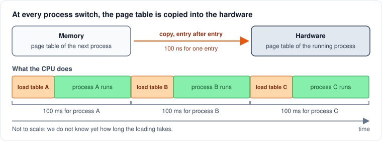
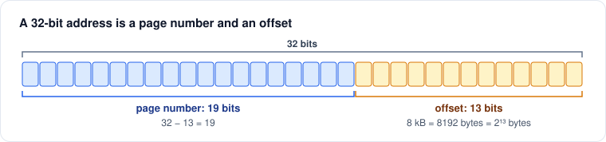
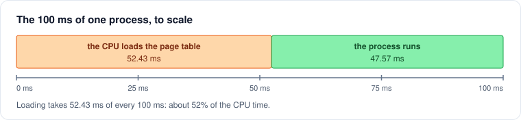

# Memory Management – Part 2

**Theory Exercises V: Memory management. Memory allocation algorithms in multiprocess systems.**

This lab covers Problems 6–10. Problems 1–5 are in Part 1, on the branch `lab9-memory-allocation-1`.

## Introduction

In Part 1 we met paging. Memory is cut into pages and frames, and a page table says where each page is stored. Paging has no external fragmentation. But paging has its own price: the page table can be very long, and every address that a program uses must be translated.

In this lab we calculate this price. Again we do not write code. The problems come from the course slides [4].

| # | Question | Topic |
|---|----------|-------|
| 6 | How much CPU time does loading the page table take? | Page table in the hardware |
| 7 | How does a two-level page table split an address? | Two-level page tables |
| 8 | How much faster is a program with twice as many frames? | Page faults |
| 9 | What hit rate does the associative memory need? | Associative memory |
| 10 | How long does it take to read a program from disk? | Reading pages from a disk |

You need only basic maths: percentages, powers such as 2¹⁰, and a calculator.

### How each problem is organised

1. **The problem** – the text of the task.
2. **Understand the situation** – what is happening, in plain words and pictures.
3. **Solution, step by step** – the calculation with an explanation of every step.
4. **Answer** – the final result.

Numbers in square brackets, for example [1], point to the [References](#references) at the end.

## Key Terms

Read these terms first.

### Terms from Part 1

- **Logical address** – an address that the program uses. **Physical address** – the real place in the memory hardware [1, §13.3].
- **Page** – a block of the logical memory of a process. **Frame** – a block of the physical memory. A page and a frame have the same size, and each page is stored in one frame [1, ch. 18].
- **Page table** – a table that the OS keeps for every process. For each page it says in which frame the page is stored [1, §18.1].
- **Page number and offset** – an address has two parts. The page number says *which page*. The offset says *which place inside that page* [1, §18.1].

### New terms

- **32-bit address space** – every address has 32 bits. So a process can use 2³² different addresses [1, §18.2].
- **Page table entry** – one line of the page table. It holds the frame number of one page [1, §18.3]. The page table has one entry for every page.
- **Process switch** (also called *context switch*) – the OS stops running one process and starts running another one [1, §6.3].

### Units

| Unit | Meaning in this lab |
|------|---------------------|
| 1 kB | 1024 bytes = 2¹⁰ bytes |
| 1 ms (millisecond) | 0.001 s |
| 1 ns (nanosecond) | 0.000 000 001 s, so 1 ms = 1 000 000 ns |

Be careful with **kB**. In the official standard, 1 kB is 1000 bytes, and the name for 1024 bytes is *kibibyte* (KiB) [2], [3]. Our problems write kB for 1024 bytes.

### Powers of two

With **b** bits we can write 2ᵇ different numbers.

| Bits | 10 | 13 | 19 | 32 |
|------|----|----|----|----|
| Different numbers | 1024 | 8192 | 524 288 | 4 294 967 296 |

---

## Problem 6 – How Much CPU Time Does Loading the Page Table Take?

*Topic: virtual memory with paging, page table in the hardware.*

### The problem

A computer has a **32-bit** address space and pages of **8 kB**. The page table of the running process is kept in the hardware. Each entry of the table has **32 bits**. When a process starts (or when the CPU switches to it), its page table is copied from memory into the hardware. Copying one entry takes **100 ns**. Every process runs for **100 ms**, and this includes the time for loading the table. What part of the CPU time is used for loading page tables?

### Understand the situation

**1. The page table has one entry for every page.**

The address space of a process is cut into pages. The page table says, for each page, in which frame it is stored. One line of the table is one **entry**.

So an address space with many pages has a long page table.


**2. At every process switch, the page table must be loaded.**

> **Hint:** The hardware must translate every address that a program uses, so this must be fast. Looking into a table in memory is slow [1, §18.4]. This computer keeps the table of the running process inside the hardware.

Every process has its own page table. When the CPU switches to another process, the OS copies the page table of that process from memory into the hardware. It copies one entry after another, and one entry takes 100 ns. During this time the process cannot run.



**3. The question.**

Every process gets 100 ms. The first part of these 100 ms is lost for loading. How large is this part?

Everything follows one chain:

```
page size  →  number of pages  →  number of entries  →  loading time  →  part of the 100 ms
```

### Solution, step by step

**Step 1 – Split the address.** An address has 32 bits. It is a page number and an offset, as in Problem 5 of Part 1. The offset chooses one byte inside a page, and a page has 8 kB:

```
8 kB = 8 × 1024 bytes = 8192 bytes = 2¹³ bytes   →   offset = 13 bits
page number = 32 − 13 = 19 bits
```



**Step 2 – Count the pages.** With 19 bits we can write 2¹⁹ different page numbers. There is one entry for every page:

```
2¹⁹ = 524 288 pages   →   524 288 entries in the page table
```

**Step 3 – Find the loading time.** Copying one entry takes 100 ns:

```
524 288 entries × 100 ns = 52 428 800 ns ≈ 52.43 ms       (1 ms = 1 000 000 ns)
```

**Step 4 – Find the part of the CPU time.** Every process has 100 ms, and 52.43 ms of them are used for loading:

```
52.43 ms ÷ 100 ms ≈ 0.524  ≈  52 %
```



### Answer

Loading page tables uses about **52%** of the CPU time. For more than half of the time the CPU only copies tables.

**What we learn.** The page table of a large address space is very long. Copying the whole table at every process switch is far too expensive. Real systems leave the page table in memory and keep only a few entries in fast hardware [1, ch. 19]. This is the associative memory of Problem 9.

### Notes on this solution

- **What are the 32 bits of an entry for?** We do not need them for the time, because the problem gives the time for one entry. They tell us the size of the table: 524 288 entries × 4 bytes = 2 097 152 bytes = 2 MB for every process.
- **Bytes, not words.** In Problem 5 the addresses counted words. Here the page size is given in kB, so one address points to one byte.

---

## Summary

| Problem | Main idea | Formula | Result |
|---|---|---|---|
| 6 | The page table has one entry for every page, and every entry must be copied | time = number of entries × time for one entry | about 52% of the CPU time |

## References

1. R. H. Arpaci-Dusseau, A. C. Arpaci-Dusseau. *Operating Systems: Three Easy Pieces*, version 1.10. Arpaci-Dusseau Books. Free online: <https://pages.cs.wisc.edu/~remzi/OSTEP/>. Chapters used: [6 – Mechanism: Limited Direct Execution](https://pages.cs.wisc.edu/~remzi/OSTEP/cpu-mechanisms.pdf), [13 – The Abstraction: Address Spaces](https://pages.cs.wisc.edu/~remzi/OSTEP/vm-intro.pdf), [18 – Paging: Introduction](https://pages.cs.wisc.edu/~remzi/OSTEP/vm-paging.pdf), [19 – Paging: Faster Translations (TLBs)](https://pages.cs.wisc.edu/~remzi/OSTEP/vm-tlbs.pdf).
2. National Institute of Standards and Technology (NIST). *Prefixes for binary multiples*. <https://physics.nist.gov/cuu/Units/binary.html>.
3. National Institute of Standards and Technology (NIST). *Metric (SI) Prefixes*. <https://www.nist.gov/pml/owm/metric-si-prefixes>.
4. Course slides: *Operačné systémy – Teoretické cvičenia V. Správa pamäti. Algoritmy prideľovania pamäti v multiprocesových systémoch.* The problems and the solution methods in this lab come from these slides and their speaker notes.
